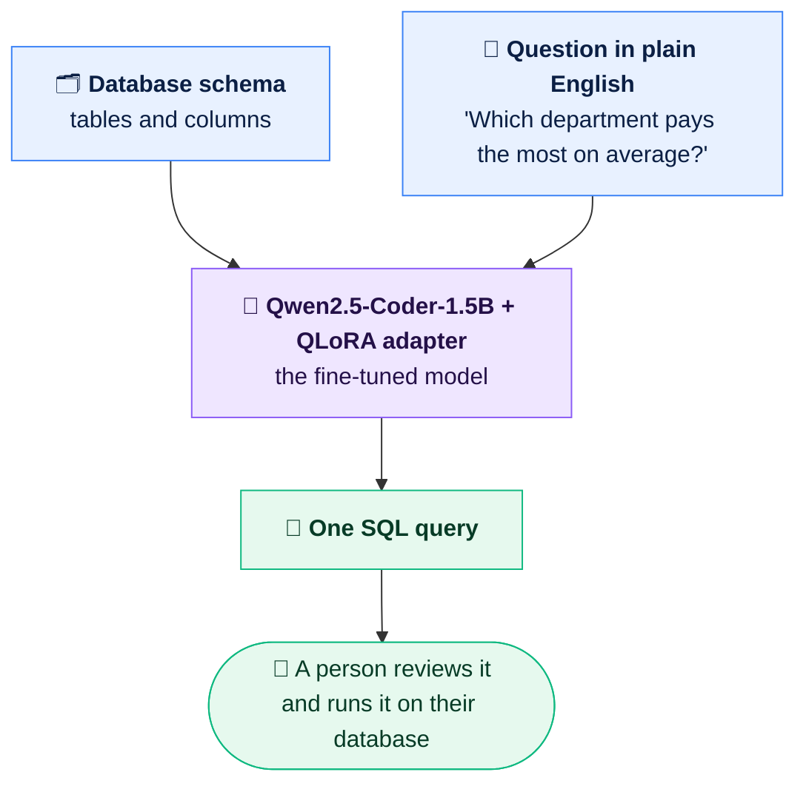
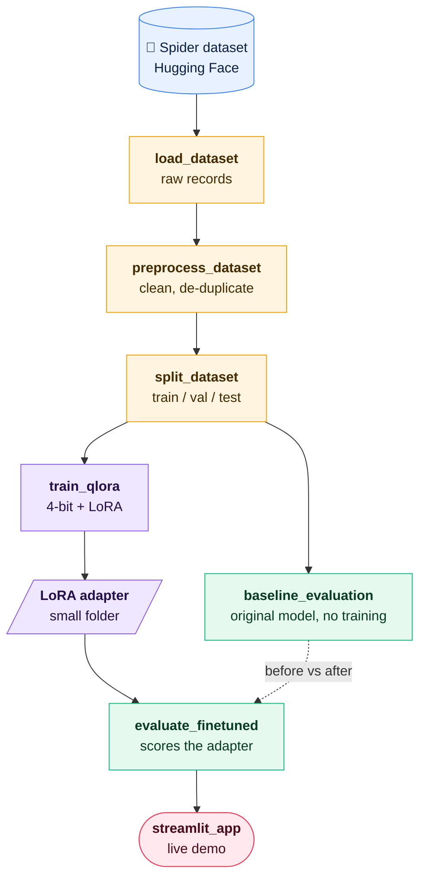
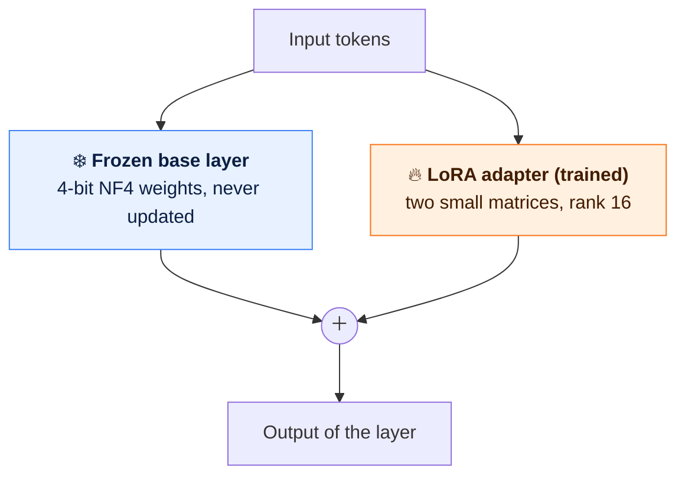

# Generic Text-to-SQL with QLoRA

Ask a database a question in plain English, get a SQL query back.
The model is **Qwen2.5-Coder-1.5B-Instruct**, fine-tuned with **QLoRA (4-bit quantization + LoRA adapters)** on the **Spider** benchmark (`SuperMax991/spider-text2sql`), and it is built to work on database schemas it has never seen.

---

## 1. What Problem Am I Solving?

Databases hold the answers to most business questions, but the language you need to get at them, SQL, is a skill many people never learn.

Picture a manager who wants to know *"Which department has the highest average salary?"* Today they have to find someone who knows SQL, explain the question, and wait. I want to remove that step.

The system takes two things as input:

1. **The database schema**: the tables and columns, written as text.
2. **A question in everyday English.**

and returns one SQL query:


---

### What the system does

Two inputs go in, one SQL query comes out, and a person stays in the loop.



### How the project is built

Data preparation, then training, then evaluation, then the demo app.



### How the models are tested

Every database belongs to exactly one split, so validation and test measure performance on schemas the model has never seen.

| Split | Databases | Purpose |
| :--- | :---: | :--- |
| 🟦 **Train** | 124 | The model learns from these only |
| 🟩 **Validation** | 16 | Unseen databases, main benchmark |
| 🟧 **Test** | 6 | Unseen databases, different SQL style |

*146 databases in total; each belongs to exactly one split. The same 200 validation questions go to every model (original model, adapter v1, adapter v2), and each is scored on exact match, relaxed match and syntax validity.*

### What the results show

Exact-match accuracy on the 200 validation questions (details and caveats in Section 10).

| Model | Exact match | |
| :--- | :---: | :--- |
| Original model | 35.5% | 🟦🟦🟦🟦🟦🟦🟦⬜⬜⬜⬜⬜⬜⬜⬜⬜⬜⬜⬜⬜ |
| Adapter v1 | 52.0% | 🟩🟩🟩🟩🟩🟩🟩🟩🟩🟩⬜⬜⬜⬜⬜⬜⬜⬜⬜⬜ |
| Adapter v2 | **56.0%** | 🟩🟩🟩🟩🟩🟩🟩🟩🟩🟩🟩⬜⬜⬜⬜⬜⬜⬜⬜⬜ |

*Each square is 5%.*

---

Two points about the design:

* **The user stays in control.** The tool returns the query for a person to read and run; it does not execute anything on its own.
* **It has to be generic.** A model that only works for one company's database is not very useful. The real test is a schema it was never trained on, so the evaluation is built around exactly that.

---

## 2. Why Fine-Tune? Why Not Just Use an Existing Model?

A general-purpose model already knows what SQL looks like. What it does not reliably do is the *specific job* here: read a schema as given, use only the names that are in it, answer the question that was actually asked, and return nothing but the query.

The usual ways it goes wrong:

* **Made-up names:** a table or column that is not in the schema.
* **The wrong question answered:** valid SQL that does something different from what was asked.
* **Extra text:** explanations and markdown wrapped around the query.

Fine-tuning fixes this by example. I show the model thousands of cases of *schema + question → correct SQL*, so the task and the output format become habits, not guesses.

I measured it instead of assuming it. The pretrained model scored **35.5%** exact match on unseen validation databases; after fine-tuning it scored **52%** (see Section 10). Its SQL was already syntactically valid, so the gain comes from picking the *right* query for the schema.

Why not update every weight of the model? Full fine-tuning needs a lot of GPU memory and time. That leads to the technique I was assigned.

---

## 3. The Assigned Concept: QLoRA with 4-Bit Quantization

**The idea in one sentence:** keep the pretrained model frozen and compressed, and teach it the new task by training only a small set of extra weights.

A way to picture it: the pretrained model is a thick textbook that nobody is allowed to rewrite. QLoRA adds sticky notes in the margins. The book is printed in a smaller, lower-resolution format to save space, and only the notes are edited during training.

### The three ingredients

| Ingredient | What it does | Tool |
| :--- | :--- | :--- |
| **4-bit quantization (NF4)** | Stores the frozen base weights in 4 bits instead of 16, cutting memory sharply. NF4 is a 4-bit format designed for the bell-curve distribution of neural-network weights. **Double quantization** also compresses the scaling constants. | `bitsandbytes` |
| **LoRA adapters** | Small trainable matrices inserted next to the frozen layers. Only these are updated, roughly 1% of the model's parameters. | `peft` |
| **Memory savers** | An 8-bit *paged* optimizer and gradient checkpointing trade a little speed for much less GPU memory. | `transformers` |

### How the pieces fit



During the forward pass the 4-bit weights are temporarily converted to higher precision for the calculation. Gradients flow only into the small adapter matrices. When training ends, all that has to be saved is the adapter, a small folder (`qlora_adapter/`) that is loaded on top of the base model.

### My settings

| Setting | Value |
| :--- | :--- |
| Base model | `Qwen/Qwen2.5-Coder-1.5B-Instruct` |
| Quantization | 4-bit **NF4**, double quantization on, bfloat16 compute (float16 if bf16 is unsupported) |
| LoRA rank / alpha / dropout | **16** / **32** / 0.05 |
| Layers adapted | attention (`q_proj`, `k_proj`, `v_proj`, `o_proj`) **and** feed-forward (`gate_proj`, `up_proj`, `down_proj`) |
| Optimizer | `paged_adamw_8bit` |
| Gradient checkpointing | on |
| Learning rate / epochs | 2e-4 / 3 (first run) |
| Batch | 2 per step x 8 accumulation steps = effective batch of 16 |
| Max sequence length | 1,024 tokens (longer examples are dropped, never truncated) |

(The exact trainable-parameter count and peak memory for each run are saved in `results/training_summary*.json`.)

### Target-only loss

The model is shown the database id, the schema and the question, but the training loss is computed **only on the SQL answer**. The prompt tokens are masked out. That way the model spends its learning on writing the query, not on memorizing the schema text it is handed.

### Why QLoRA suits this project

* It fits a **laptop GPU** (RTX 5060 Laptop): the base model is compressed and almost all of it is frozen.
* Adapters are tiny, so I can keep several versions side by side (`qlora_adapter`, `qlora_adapter_v2`) and compare them without touching the original.
* The base model's general coding knowledge is preserved because its weights never change.

---

## 4. Dataset and Base Model

**Dataset: Spider.** Natural-language questions, SQL queries and schemas from many different domains. I picked it because the goal is one model that works across schemas, not one tuned to a single database. Each record has `db_id`, `question`, `query` and `db_schema`.

**Held-out evaluation is cross-database.** Both the validation and test splits are built from whole databases that never appear in training, so the scores measure how the model handles an unfamiliar schema.

**Base model: Qwen2.5-Coder-1.5B-Instruct.** A code-focused model of about 1.5 billion parameters that follows instructions. Text-to-SQL needs exactly that: read a schema, follow an instruction, write structured code. It is also small enough to fine-tune on my own GPU.

---

## 5. Pipeline Overview

Three small, separate scripts prepare the data:

| Script | Purpose | Key Outputs |
| :--- | :--- | :--- |
| **`load_dataset.py`** | Downloads the dataset, inspects its structure, columns and splits, and saves the raw records locally. | `data/raw/raw_*.json`<br>`data/raw/dataset_info.json` |
| **`preprocess_dataset.py`** | Checks required fields, standardizes whitespace and trailing semicolons, drops invalid and duplicate records, and keeps every schema intact. | `data/processed/processed_*.json`<br>`data/processed/preprocessing_stats.json` |
| **`split_dataset.py`** | Builds train / validation / test, with the validation split made of **whole databases**, and audits leakage and database overlap. | `data/splits/train.json`<br>`data/splits/validation.json`<br>`data/splits/test.json`<br>`data/splits/split_stats.json` |

Then training and evaluation:

| Script | Purpose |
| :--- | :--- |
| **`train_qlora.py`** | Loads the model in 4-bit, attaches the LoRA adapters, builds the masked training examples and runs the training loop. It can also continue from an existing adapter. |
| **`baseline_evaluation.py`** | Scores the original, untuned model. |
| **`evaluate_finetuned.py`** | Scores a trained adapter and compares it with the baseline or with another adapter. |

`prompts.py` is the single prompt definition shared by training and both evaluators. `eval_utils.py` holds the shared sampling, metrics and model loading.

---

## 6. Setup

Install the required packages in your Python environment:

```powershell
cd D:\GenericSQLGenerator
pip install -r requirements.txt
```

*(Install PyTorch first with the build for your CUDA version; see the comments in `requirements.txt`.)*

---

## 7. Running the Data Pipeline

Run the scripts in order.

### Step 1: Load and inspect the raw dataset
```powershell
python load_dataset.py
```
Downloads `SuperMax991/spider-text2sql`, prints the size, columns (`db_id`, `question`, `query`, `db_schema`) and a sample record, and writes raw files to `data/raw/`.

### Step 2: Clean and preprocess
```powershell
python preprocess_dataset.py
```
Standardizes whitespace and trailing semicolons (the SQL text itself is left untouched), drops malformed or empty records, removes duplicate `(db_id, question, query)` triples, and keeps every schema. It prints how many records were dropped and the retention rate.

### Step 3: Split and leakage audit
```powershell
python split_dataset.py
```
Builds `train.json`, `validation.json` and `test.json`, checks that no identical `(db_id, question)` example appears in more than one split, and prints how many databases are unseen in training for validation and test.

---

## 8. Schema Format

Each processed record keeps a standard structure:

```json
{
  "id": "train_00001",
  "db_id": "concert_singer",
  "question": "How many singers do we have?",
  "query": "SELECT count(*) FROM singer;",
  "db_schema": "stadium : stadium_id (number) , location (text) ... | singer : singer_id (number) , name (text) ...",
  "question_toks": ["How", "many", "singers", "do", "we", "have", "?"]
}
```

---

## 9. Fine-Tuning and Evaluation

```powershell
python split_dataset.py --force                 # re-split (database-disjoint validation); use --force after re-preprocessing
python baseline_evaluation.py -n 100            # seeded random sample, base model
python train_qlora.py --max-steps 50            # smoke test, then run without --max-steps
python evaluate_finetuned.py -n 100             # same samples, adapter attached, prints comparison
```

Re-run order after changing the data code: `preprocess_dataset.py` -> `split_dataset.py --force` -> baseline -> train -> evaluate_finetuned.

**Second round (continue the first adapter):**

```powershell
python train_qlora.py --init-adapter qlora_adapter --output-name qlora_adapter_v2 --lr 5e-5 --eval-steps 100 --save-steps 100 --early-stopping-patience 3
python evaluate_finetuned.py --adapter qlora_adapter_v2 --compare-with qlora_adapter --split validation --sample-size 200
python evaluate_finetuned.py --adapter qlora_adapter_v2 --compare-with qlora_adapter --split validation --compare-only   # re-compare saved results, no GPU
```

The first adapter is never overwritten, because each run saves to its own folder.

**What the evaluation reports**

| Metric | Meaning |
| :--- | :--- |
| **Exact match** | Normalized string match with the reference SQL. Case, spacing and quote style are ignored; string values are not. Strict: a correct query written differently counts as a miss. |
| **Relaxed match** | Same, but ignoring table aliases and join order. A lenient upper bound. |
| **Syntax validity** | Whether SQLite can parse the query. |
| **Paired comparison** | Question by question: how many the new model fixed, how many it broke, and a sign test for whether the difference is more than chance. |

Notes:
* Using your own database: convert its schema to the same compact format as `db_schema` (`table : col (type) , col (type) | table2 : ...`).
* `INCLUDE_DB_ID` in `prompts.py` controls whether the db_id label is shown to the model (default off). Changing it requires retraining.

---

## 10. Results

All three models were scored on the **same 200 random validation questions** from 16 databases not seen in training.

| Model | Exact match | Relaxed match | Syntax valid | Avg. latency | Peak GPU memory (inference) |
| :--- | :---: | :---: | :---: | :---: | :---: |
| Original model | 35.5% | 38.5% | 100% | 1.23 s | 1.14 GB |
| QLoRA adapter v1 | 52.0% | 60.0% | 99.5% | 2.06 s | 1.21 GB |
| QLoRA adapter v2 (continued) | **56.0%** | **62.0%** | 100% | 1.93 s | 1.21 GB |

**How to read this**

* **Fine-tuning helped.** From the original model to v1, question by question, 37 were fixed and only 4 broken, which is far beyond chance.
* **v2 versus v1 is not settled.** A 4-point gap on 200 questions is small, and the second run stopped at step 600 of 1,161 planned steps (early stopping), which suggests validation loss had stopped improving. I treat the two adapters as roughly equal unless the paired comparison says otherwise.
* **The test split showed no gain** (5% exact match for both models on 100 questions). Its six databases use a different SQL style from Spider's training data (unusual aliasing, `COUNT(DISTINCT ...)` conventions), so string matching rarely lines up. The validation split, which follows the training style, is the fairer measure of what fine-tuning changed.
* **Latency rose** after fine-tuning because the adapter runs next to the base model; merging it into the base weights is the usual fix for deployment.

---

## 11. Limitations and Failure Analysis

* **Aggregation choices.** In the misses on the test split, the model wrote `COUNT(*)` where the reference used `COUNT(DISTINCT col)` or `COUNT(col)`. These are different operations: rows, non-null values and unique values. The query is valid SQL but can return a different number.
* **Schema linking.** On validation, the typical miss was putting a column on the wrong table or joining on the wrong key (for example filtering `format` on `song` when the column lives on `files`). These queries pass the syntax check but would fail or return wrong rows when run.
* **No execution check yet.** Evaluation compares query text and SQLite syntax; it does not run the SQL on a database, because the dataset ships schemas without the database files. Two queries can differ as text and still return the same answer, and the reverse.

**Next steps:** targeted training examples for aggregations and multi-table joins, and execution-based evaluation against real sample databases.

---

## 12. Interactive Web UI (Streamlit)

Launch the Generic Text-to-SQL web interface:

```powershell
pip install streamlit
python -m streamlit run streamlit_app.py
```
* Enter a schema in three ways: a visual table/column builder, pasted `CREATE TABLE` DDL or the compact format, or an upload (`.sql`, SQLite `.db`, or CSV files).
* Accepts natural-language questions and generates schema-grounded SQL.
* Validates SQLite syntax, checks that the tables the query uses exist in your schema, and offers a `.sql` download.
* Displays the detected GPU and the QLoRA training telemetry.

---

## 13. Suggested Order for a Walkthrough or Recording

| # | Show | Say |
| :-: | :--- | :--- |
| 1 | "At a Glance" diagrams, then the Section 1 example table | The problem: plain-English question in, SQL query out, and how the project is organized. |
| 2 | Section 2 | Why a general model is not enough, and what fine-tuning adds. |
| 3 | Section 3 diagram and settings | QLoRA: frozen 4-bit model plus small trained adapters. |
| 4 | Output of `split_dataset.py` | Unseen databases are in validation and test, with no leakage. |
| 5 | Output of `baseline_evaluation.py` | The starting point before any training. |
| 6 | Training log | Loss falling, checkpoints, memory and time. |
| 7 | Output of `evaluate_finetuned.py` | Before and after on the same questions, with the paired comparison. |
| 8 | Section 11 | Where it still fails, and what to do next. |
| 9 | Streamlit app | A live question against a schema. |